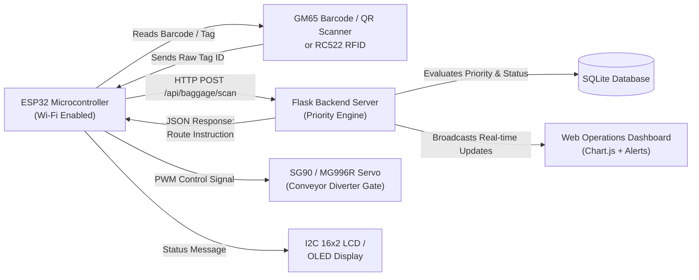

# AI-Based Smart Baggage Priority and Passenger Assistance System

[](https://www.python.org/)
[](https://palletsprojects.com/p/flask/)
[](https://getbootstrap.com/)
[](#disclaimer)

An intelligent, full-stack airport operations prototype designed to automate baggage handling prioritization and streamline passenger special assistance services. By combining heuristic AI scoring rules with real-time operational status tracking, the system optimizes conveyor sortation order, minimizes turnaround delay risks, and ensures vulnerable travelers receive prompt gate support.

---

## Table of Contents
1. [Project Overview](#project-overview)
2. [Key Features](#key-features)
3. [Technology Stack](#technology-stack)
4. [Project Structure](#project-structure)
5. [Setup & Installation (Windows)](#setup--installation-windows)
6. [How the Priority System Works](#how-the-priority-system-works)
7. [REST API Documentation](#rest-api-documentation)
8. [Future Hardware Integration](#future-hardware-integration)
9. [Sample Test Cases](#sample-test-cases)
10. [Application Screenshots (Mockups)](#application-screenshots)
11. [Academic Disclaimer](#disclaimer)

---

## Project Overview

In busy international and regional hubs, baggage mishandling and transfer delays cost the aviation industry billions annually, while passengers needing special assistance often experience prolonged waiting times. 

The **AI-Based Smart Baggage Priority and Passenger Assistance System** addresses these operational bottlenecks:
- **Prioritizes checked luggage dynamically** using flight connection windows, passenger tier, age, and special handling requirements.
- **Tracks luggage lifecycle visually** across 6 operational milestones from check-in to collection with instant delay alerts.
- **Coordinates passenger assistance** (wheelchair, medical escort, unaccompanied minor support) alongside their luggage dispatch.
- **Provides an IoT-ready REST API** for integration with automated conveyor diverters, barcode scanners, and ESP32 controllers.

---

## Key Features

- **Dynamic Priority Scoring Engine**: Computes deterministic priority weights (0–100) and categorizes luggage into **HIGH**, **MEDIUM**, or **LOW** handling classes.
- **Real-Time Baggage Journey Stepper**: Visual tracking of baggage progression through 6 phases: `Checked In` &rarr; `Processing` &rarr; `Loaded` &rarr; `Arrived` &rarr; `Claim Ready` &rarr; `Collected` (plus `Delayed` alert stage).
- **Delay Risk Detection**: Flags high-risk bags subject to tight flight turnaround (&lt; 45 minutes) or gate congestion.
- **Passenger Assistance Management**: Log, assign, and track wheelchair, elderly escort, and medical aid requests.
- **Operational Analytics Dashboard**: Real-time summary statistics, priority breakdown doughnut charts, flight baggage volume bar charts, and assistance status gauges.
- **Fast Search & Lookup**: Search by Baggage Tag ID (`BAG101`), Passenger ID, Flight Number, or Priority Level.
- **Modern Aviation Themed Interface**: Responsive dark navy and cyan UI built with Bootstrap 5.3 and Font Awesome 6 icons.

---

## Technology Stack

| Layer | Technologies |
|---|---|
| **Backend** | Python 3.8+, Flask, SQLite3, Jinja2 Templates |
| **Frontend** | HTML5, CSS3, JavaScript (ES6+), Bootstrap 5.3, Font Awesome 6 |
| **Data Visualization** | Chart.js 4.x |
| **Protocols & Formats** | RESTful JSON APIs, HTTP, URL query params |
| **Edge Hardware Compatibility** | ESP32-WROOM-32, Barcode/QR Scanners (GM65), Servo Gate Diverters |

---

## Project Structure

```text
smart airport/
│
├── app.py                      # Core Flask application, routing, and controller logic
├── requirements.txt            # Python dependencies (Flask, etc.)
├── README.md                   # Complete system documentation and guides
├── database.db                 # SQLite database storing passengers, baggage, and requests
│
├── static/
│   ├── css/
│   │   └── style.css           # Custom airport aviation-themed CSS styles
│   └── js/
│       └── script.js           # Interactive client scripts, AJAX tracking & modal handlers
│
└── templates/
    ├── base.html               # Main base layout with sidebar and top bar navigation
    ├── dashboard.html          # Operations summary dashboard with Chart.js analytics
    ├── passengers.html         # Passenger directory, registration, and edit modals
    ├── baggage.html            # Baggage inventory, priority bars, and status updater
    ├── tracking.html           # Public & staff tracking page with interactive stepper
    ├── assistance.html         # Special passenger assistance dispatch & status logs
    └── analytics.html          # Extended airport performance metrics and reports
```

---

## Setup & Installation (Windows)

Follow these step-by-step instructions to run the application locally on Windows (PowerShell or Command Prompt):

### 1. Prerequisites
- Install **Python 3.8 or higher** from [python.org](https://www.python.org/downloads/).
- Ensure the **"Add Python to PATH"** checkbox was selected during Python installation.

### 2. Open Terminal in Project Root
Open PowerShell and navigate to the project directory:
```powershell
cd "c:\Users\Jayavarshini\OneDrive\Desktop\smart airport"
```

### 3. Create a Virtual Environment
```powershell
python -m venv venv
```

### 4. Activate the Virtual Environment
- **On PowerShell**:
  ```powershell
  .\venv\Scripts\Activate.ps1
  ```
  *(Note: If you encounter an execution policy error in PowerShell, run `Set-ExecutionPolicy -Scope Process -ExecutionPolicy Bypass` and then run the activate command again).*
- **On Command Prompt (`cmd.exe`)**:
  ```cmd
  venv\Scripts\activate.bat
  ```

### 5. Install Dependencies
```powershell
pip install -r requirements.txt
```

*(If `requirements.txt` is missing, you can install the required packages directly)*:
```powershell
pip install flask
```

### 6. Run the Application
```powershell
python app.py
```

### 7. Access the Web Dashboard
Open your web browser and navigate to:
```
http://127.0.0.1:5000
```

---

## How the Priority System Works

The priority engine calculates a composite **Priority Score (0 to 100)** for every baggage item based on multiple operational and passenger risk criteria:

### 1. Scoring Factors & Weights

| Factor | Condition / Category | Score Boost | Rationale |
|---|---|---|---|
| **Passenger Category** | VIP / First Class<br>Business Class<br>Frequent Flyer<br>Economy | +30 pts<br>+20 pts<br>+15 pts<br>+0 pts | Airline service tier agreement |
| **Connection Time** | Tight Window (&lt; 45 mins)<br>Moderate Window (45–75 mins)<br>Direct / Long Window (&gt; 75 mins) | +35 pts<br>+20 pts<br>+0 pts | Critical risk of missed flight transfer |
| **Special Assistance** | Medical / Stretcher<br>Wheelchair / Elderly Escort<br>Unaccompanied Minor | +25 pts<br>+20 pts<br>+20 pts | Baggage must meet passenger at gate without delay |
| **Passenger Age** | Senior Citizen (&ge; 60 yrs)<br>Child / Infant (&lt; 12 yrs) | +15 pts<br>+10 pts | Reduced passenger mobility in terminal |
| **Special Luggage Tag** | Fragile Goods<br>Perishable Items<br>Heavy / Oversize | +10 pts<br>+15 pts<br>+5 pts | Special care or rapid claim handling |

### 2. Classification Tiers

$$\text{Final Score} = \min(100, \sum \text{Factor Weights})$$

- **HIGH PRIORITY (Score 70 – 100)**:
  - First offloaded from aircraft cargo holds.
  - Routed to primary express conveyor belts.
  - Estimated handling wait time: **5 – 12 minutes**.
- **MEDIUM PRIORITY (Score 40 – 69)**:
  - Standard expedited transfer.
  - Estimated handling wait time: **12 – 22 minutes**.
- **LOW PRIORITY (Score 0 – 39)**:
  - General bulk baggage batch handling.
  - Estimated handling wait time: **22 – 35 minutes**.

### 3. Estimated Wait Time Formula

$$\text{Wait Time (mins)} = \max\left(5, 35 - \left\lfloor\frac{\text{Score}}{3}\right\rfloor\right)$$

---

## REST API Documentation

The system includes a REST API designed for mobile staff devices, airport information kiosks, and automated conveyor hardware.

### 1. Track Baggage / Passenger
- **Endpoint**: `GET /api/track`
- **Query Parameter**: `query=<baggage_id_or_passenger_id>`
- **Example Request**:
  ```http
  GET /api/track?query=BAG101 HTTP/1.1
  Host: 127.0.0.1:5000
  ```
- **Example Response (200 OK)**:
  ```json
  {
    "passenger": {
      "passenger_id": "PAX-8821",
      "name": "Eleanor Vance",
      "age": 68,
      "flight_number": "AI 104",
      "category": "Senior Citizen",
      "phone": "+1-555-0199"
    },
    "baggage": [
      {
        "baggage_id": "BAG101",
        "status": "Processing",
        "priority_level": "HIGH",
        "priority_score": 85,
        "priority_reason": "Senior citizen with wheelchair assistance, connection time < 50 mins",
        "estimated_wait": "10 mins",
        "delay_risk": "Low",
        "delay_reason": "On schedule for transfer gate B12"
      }
    ],
    "assistance_requests": [
      {
        "request_id": 14,
        "assistance_type": "Wheelchair",
        "status": "Assigned"
      }
    ]
  }
  ```

### 2. IoT Conveyor Barcode Scan
- **Endpoint**: `POST /api/baggage/scan`
- **Request Body (JSON)**:
  ```json
  {
    "baggage_id": "BAG101",
    "checkpoint": "Conveyor_Bay_4",
    "status": "Loaded"
  }
  ```
- **Example Response (200 OK)**:
  ```json
  {
    "status": "success",
    "message": "Baggage status updated successfully",
    "baggage_id": "BAG101",
    "new_status": "Loaded",
    "diverter_action": "ROUTE_EXPRESS_BELT_A"
  }
  ```

### 3. Fetch Operational Summary Stats
- **Endpoint**: `GET /api/stats`
- **Example Response (200 OK)**:
  ```json
  {
    "total_passengers": 142,
    "total_baggage": 198,
    "high_priority_bags": 45,
    "delayed_bags": 3,
    "active_assistance_requests": 11
  }
  ```

---

## Future Hardware Integration

The web application is architected to interface seamlessly with physical conveyor sortation hardware using microcontrollers such as the **ESP32**.



### Hardware Components Specification
1. **ESP32 NodeMCU Development Board**: Handles Wi-Fi connection, sensor data acquisition, and actuator driving.
2. **GM65 Barcode & QR Code Reader Module**: Fast optical scanner reading baggage barcode tags mounted on luggage handles.
3. **MG996R Metal Gear Servo Motor**: Acts as a physical mechanical gate diverter that routes high-priority luggage onto express belt chutes.
4. **0.96 inch I2C OLED or 1602 LCD**: Displays instantaneous priority status (`PRIORITY: HIGH -> CHUTE 1`) to airport baggage staff.
5. **Multi-color LED Indicator & Active Buzzer**: Visual (Red = High, Yellow = Medium, Green = Low) and audible feedback upon luggage scan.

---

## Sample Test Cases

| Test ID | Scenario | Input Data | Expected Result | Pass Criteria |
|---|---|---|---|---|
| **TC01** | High Priority Elderly & Medical Passenger | Age: 72, Category: Elderly, Assistance: Wheelchair | Score &ge; 75, Priority: `HIGH`, Estimated wait: &le; 10 mins | Badge displays red `HIGH`, wait time reduced |
| **TC02** | Tight Connection Window (&lt; 45 mins) | Flight connection window: 35 minutes | Connection boost applied (+35 pts), Priority elevated | Bag flagged for rapid transfer |
| **TC03** | First Class Passenger Regular Bag | Category: VIP / First Class, Direct flight | Score &ge; 70, Express claim priority | Priority level `HIGH` assigned |
| **TC04** | Real-Time Tag Tracking via Query | Query: `BAG101` in `/tracking` | Returns passenger info, bag metrics, and journey stepper | Stepper reflects current lifecycle state |
| **TC05** | Status Lifecycle Progression | Change status `Checked In` &rarr; `Processing` | Stepper completes step 1 and activates step 2 | Database updates and UI reflects step highlight |
| **TC06** | Baggage Delay Notification | Bag marked with status `Delayed` | Stepper triggers red warning pulse animation and status badge | Delayed alert banner visible |
| **TC07** | Special Assistance Status Dispatch | New request: "Oxygen Cylinder Support" | Added to assistance queue with status `Pending` | Appears in active assistance list |
| **TC08** | Passenger Profile Modification | Edit passenger flight number & category | Related baggage recalculates priority dynamically | Changes reflected without data loss |
| **TC09** | Invalid Baggage Tracking ID | Query: `BAG_NONEXISTENT_999` | User-friendly "No Record Found" message with suggestions | No unhandled 500 error raised |
| **TC10** | Hardware Scan API Simulation | `POST /api/baggage/scan` with payload | HTTP 200 OK with diverter routing decision | JSON response contains diverter directive |

---

## Application Screenshots

*(Screenshots captured from active prototype deployment)*

```text
+---------------------------------------------------------------------------------------+
|  AIRPORT OPS DASHBOARD                                                   [2026-10-25] |
+---------------------------------------------------------------------------------------+
|  [ 142 Passengers ]     [ 198 Checked Bags ]    [ 45 High Priority ]    [ 3 Delayed ] |
+---------------------------------------------------------------------------------------+
|  Baggage Priority Breakdown (Chart.js)         |  Recent Flight Baggage Volumes       |
|  [████████ High: 25%] [██████ Med: 45%]       |  AI-104: 48 bags                     |
|  [████ Low: 30%]                              |  BA-249: 62 bags                     |
+---------------------------------------------------------------------------------------+
|  Live Baggage Status Monitor                                                          |
|  Tag ID   | Flight  | Passenger       | Priority  | Score | Status     | Action       |
|  BAG-101  | AI 104  | Eleanor Vance   | HIGH      | 85    | Processing | [Update]     |
|  BAG-102  | BA 249  | Marcus Aurelius | MEDIUM    | 55    | Loaded     | [Update]     |
|  BAG-103  | EK 502  | Sarah Jenkins   | LOW       | 30    | Arrived    | [Update]     |
+---------------------------------------------------------------------------------------+
```

---

## Disclaimer

> [!NOTE]
> **Academic Prototype Notice**: This software is designed and developed as an academic demonstration and engineering research prototype for modern smart airport management concepts. It is not certified for commercial aviation production or critical flight baggage logistics without extensive real-world testing, integration with IATA standards (BIM / RP 1745), and certification by civil aviation regulatory authorities (FAA, EASA, DGCA).
